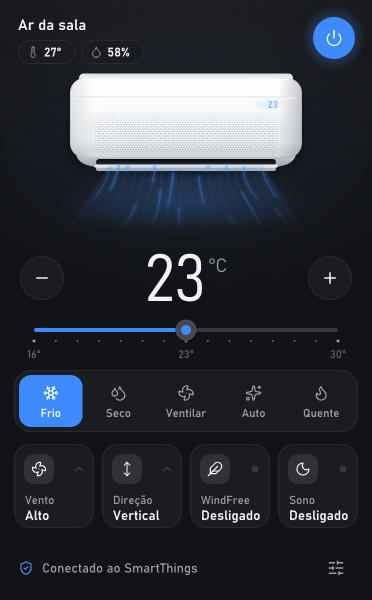
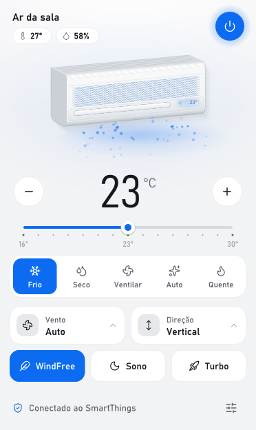
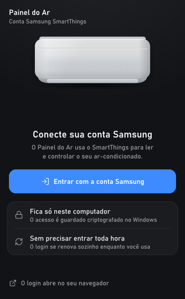
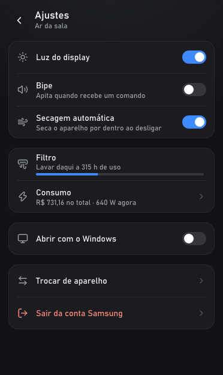

# Painel do Ar

Painel na bandeja do Windows para controlar um ar-condicionado Samsung pelo SmartThings, feito em Rust e desenhado direto na tela, sem navegador embutido.

O ícone na bandeja mostra a temperatura do ambiente, com uma barrinha na cor do modo quando o ar está ligado. Passando o mouse, aparecem também a temperatura programada e a umidade. Um clique abre o painel, e clicar fora ou apertar Esc fecha. O botão direito abre o menu com ligar e desligar, atualizar, abrir com o Windows e sair.

| Tema escuro | Tema claro | Conexão | Ajustes |
| --- | --- | --- | --- |
|  |  |  |  |

## Baixar

O exe pronto fica nas [releases](https://github.com/juserrrrr/ar-tray/releases/latest). Baixe, abra e entre com a conta Samsung. Ele não é assinado, então o Windows pode mostrar "O Windows protegeu o computador": clique em **Mais informações** e **Executar assim mesmo**.

## Por que é leve

- **Sem navegador.** O painel é desenhado em Rust com [tiny-skia](https://github.com/linebender/tiny-skia) numa janela comum do Windows. Os cantos arredondados e a sombra são do próprio Windows 11.
- **Só redesenha o que muda.** A parte fixa do painel é desenhada uma vez por mudança. A cada quadro (30 por segundo, só com o painel aberto) entra apenas o vento animado.
- **Memória devolvida ao fechar.** Os quadros do painel são liberados quando ele fecha.
- **Sem Node e sem Electron.** O login e a API da SmartThings são chamados direto do Rust, e o TLS é o do próprio Windows.

Num PC com Windows 11, conectado a um ar, o exe tem cerca de 1,9 MB e roda num processo só, com uns 6 MB de memória privada com o painel fechado e uns 9 MB com ele aberto.

## Requisitos

- Windows 10 ou 11. No Windows 10 os cantos ficam retos.
- Ar-condicionado Samsung cadastrado no app SmartThings.
- Para compilar: Rust (toolchain MSVC) e o Visual Studio Build Tools com C++.

## Compilar e rodar

```
cargo build --release
target\release\ar-tray.exe
```

Na primeira vez, o painel abre na tela **Conecte sua conta Samsung**. O botão **Entrar com a conta Samsung** abre o login no navegador, e o painel fica aberto ao lado mostrando o andamento, com opções para abrir a página de novo ou cancelar. Com um ar-condicionado na conta, ele já aparece; com vários, o painel pergunta qual controlar. Abrir o exe de novo com ele já rodando só abre o painel.

O login usa o mesmo cliente da CLI oficial da SmartThings: ele se renova sozinho e só pede para entrar de novo depois de 30 dias sem uso.

Para ver o painel sem conta, com um aparelho de mentira:

```
target\release\ar-tray.exe --demo
```

## Testes

- `cargo test`: comandos, fila, telas, cliques e o ícone da bandeja.
- `cargo test smartthings -- --ignored`: chamadas reais à SmartThings, sem login.
- `cargo test preview -- --ignored`: salva imagens do painel em vários estados, nos dois temas, em `target\preview`.

Para gerar o exe de uma release sem caminhos da máquina dentro dele, rode `powershell -ExecutionPolicy Bypass -File tools\gerar-release.ps1`. O exe fica em `dist\`, com o hash SHA-256 ao lado.

## Usar o painel

- **Temperatura**: botões − e +, o controle deslizante ou as setas do teclado.
- **Modo**: um toque na fileira de modos. Aparecem só os modos que o aparelho aceita.
- **Vento e Direção**: abrem uma lista com as opções do aparelho.
- **WindFree, Sono e Turbo**: ligam e desligam direto. O Turbo é o resfriamento rápido da Samsung: roda por um tempo e volta sozinho para o ajuste anterior, sem mudar temperatura nem vento. Enquanto ele roda, o aparelho trava a temperatura e o vento, e o painel deixa esses controles apagados. Os três ficam apagados nos aparelhos que não têm.
- **Ajustes** (canto de baixo): luz do display, manter o display apagado, bipe, secagem automática, filtro, consumo, abrir com o Windows, controle local, trocar de aparelho e sair da conta Samsung.
- **Manter display apagado**: o ar acende a luz do display de novo toda vez que liga, porque não guarda esse ajuste (o do bipe ele guarda). Com essa opção, o app apaga a luz sozinho uns 2 segundos depois que o ar liga, seja pelo app ou pelo controle remoto. Com o painel fechado, o app confere o ar a cada 20 segundos em vez de 60, para perceber logo quando ele foi ligado pelo controle.

## Controle local pela rede

Por padrão o app **procura o ar na rede sozinho** e, achando, controla direto, sem pedir a conta Samsung. A conta só é necessária se o ar não for encontrado na rede, ou se você quiser conectá-la em **Ajustes > Conectar conta Samsung**. No rodapé aparece a via ativa: "Ligado ao ar pela rede" ou "Conectado ao SmartThings".

Com o controle local, cada comando vai direto ao ar em uma fração de segundo e o estado é lido na hora. Se o ar não responder na rede e houver uma conta conectada, o app usa a SmartThings como reserva naquele comando.

Em **Ajustes > Controle local** dá para ligar ou desligar esse modo, procurar o ar de novo e, se houver mais de um, escolher qual controlar.

O ar aceita a conexão local porque o app apresenta a mesma identidade (um certificado gerado no próprio PC) que a nuvem da Samsung usa. Essa parte segue o que os projetos [LocalThings](https://github.com/mbillow/localthings) e [SmartThings-Local](https://github.com/QuiteYellow/SmartThings-Local) descobriram. Não é um recurso oficial da Samsung: uma atualização do aparelho pode fechar esse caminho. O ar precisa continuar cadastrado na conta SmartThings. Vale reservar o IP do ar no roteador, porque a porta dele pode mudar quando reinicia; se isso acontecer, o app procura de novo sozinho.

Em **Ajustes > Consumo** aparecem a potência agora, o gasto do mês em kWh e em reais, e o contador do aparelho desde a instalação. Os reais são estimados com o preço do kWh que você ajusta ali, pela conta de luz. A potência não é ao vivo: o ar manda a leitura à SmartThings a cada 5 minutos.

A API da SmartThings não informa o consumo do mês, só o contador total do aparelho. Por isso o app guarda a última leitura de cada mês, e o mês seguinte começa exatamente de onde o anterior parou, mesmo que o app esteja fechado na virada. No primeiro mês, toque em **Este mês** e digite os kWh que o app SmartThings mostra para o mês; o painel segue contando a partir daí.

O painel segue o tema claro ou escuro do Windows. Quando o Windows inicia o app, ele fica só no ícone, sem abrir o painel.

Mudanças feitas com o ar desligado ficam guardadas e são aplicadas quando ele liga. Cliques seguidos viram um comando só.

## Onde ficam os dados

Tudo fica em `%APPDATA%\dev.ar-tray.desktop`:

- `sessao.bin`: o login da SmartThings, criptografado com a conta do Windows (DPAPI).
- `device.json`: o aparelho escolhido. Apague para o app procurar de novo, ou edite para escolher outro:

  ```json
  { "id": "ID-DO-APARELHO", "nome": "Ar da sala" }
  ```

- `settings.json`: se o app abre com o Windows, o preço do kWh e a leitura de energia do começo do mês.
- `log.txt`: os passos do login e qualquer falha, com a linha do código quando o `.pdb` está ao lado do exe.

## Como funciona

- `src/smartthings.rs`: login no navegador e chamadas da API. Usa o mesmo cliente público (PKCE) da [CLI oficial da SmartThings](https://github.com/SmartThingsCommunity/smartthings-cli), que renova o acesso sozinho e só pede login de novo depois de 30 dias sem uso.
- `src/ac.rs`: transforma os ajustes em comandos e confere se o ar aplicou cada um. A `HybridUnit` tenta a rede primeiro e usa a SmartThings como reserva.
- `src/local.rs`: a conexão segura com o ar na rede (DTLS 1.2 com [rtc-dtls](https://github.com/webrtc-rs/rtc) e CoAP). `src/localac.rs` mapeia os recursos do ar para os campos do painel e acha o aparelho na rede. `src/cbor.rs` lê e escreve o formato que o ar usa.
- `src/bridge.rs`: estado da conta, fila de comandos e atualização, a cada 15 segundos com o painel aberto e 60 com ele fechado.
- `src/shell.rs`: ícone e menu da bandeja, janela do painel, pintura e entrada.
- `src/panel.rs`: layout, desenho e cliques do painel e das telas de conexão. `src/scene.rs` desenha o aparelho e o vento.
- `src/gfx.rs`: formas, degradês, texto com a Bahnschrift do Windows e ícones.
- `src/tray_icon.rs`: o número da bandeja.
- `tools/gerar-icones.mjs` gera `src/icons.rs` a partir do pacote `lucide`.

## Problemas comuns

- **"O SmartThings não respondeu"**: veja se o aparelho aparece online no app SmartThings e use "Tentar outra vez" no rodapé do painel.
- **Voltou a tela de conexão**: o acesso venceu depois de 30 dias parado. É só entrar de novo.
- **"Nenhum ar-condicionado"**: entre com a mesma conta Samsung em que o aparelho está cadastrado.
- **"O ar recusou…"**: o aparelho não aceita aquele ajuste no modo atual, e o painel mostra de novo o que ele está usando.
- **Comportamento estranho**: o `log.txt` na pasta de dados registra os passos do login e as falhas.

## Desinstalar

No menu do ícone, desmarque "Iniciar com o Windows" e escolha **Sair**. Depois apague o exe e a pasta `%APPDATA%\dev.ar-tray.desktop`.

## Créditos

A ideia de um painel na bandeja para esses aparelhos e parte da lógica de comandos vieram do projeto [samsung-windfree-tray-app](https://github.com/c0dag/samsung-windfree-tray-app), de @c0dag.

Ícones do [Lucide](https://lucide.dev), sob a licença ISC, com o texto completo em [LICENSES/lucide.txt](LICENSES/lucide.txt).

Samsung, WindFree e SmartThings são marcas da Samsung. Este projeto é independente e não tem ligação com a empresa.
